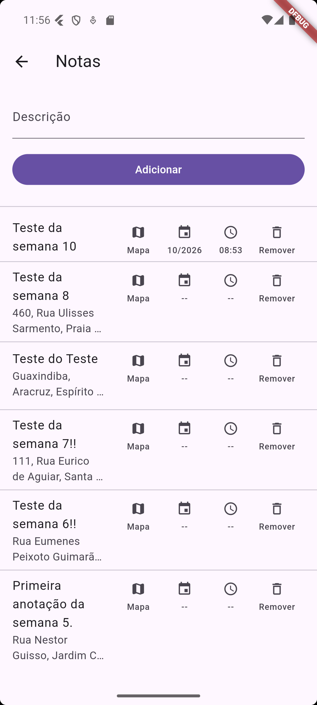
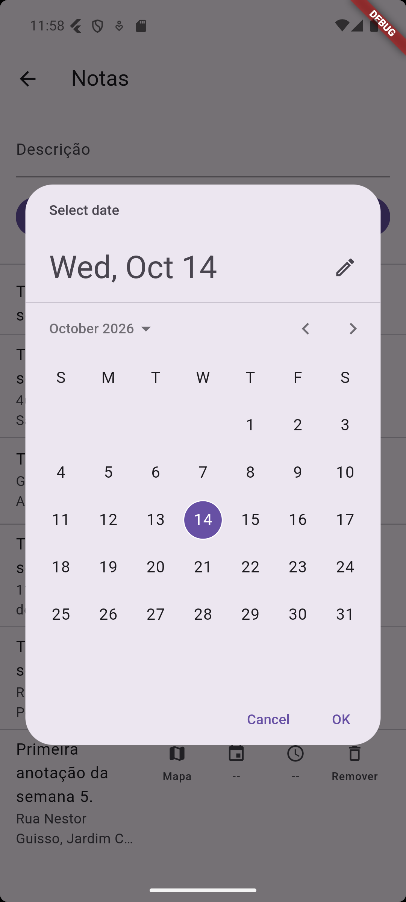
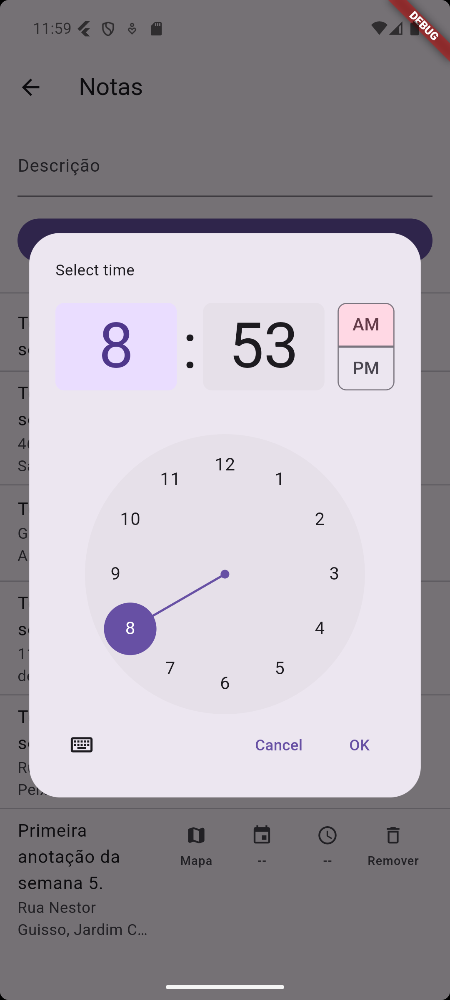

# 📅 FirebaseApp - Semana 10: Datas e horários

Aplicativo desenvolvido na disciplina de **Desenvolvimento de Aplicativos II**, do curso de **Tecnologia em Sistemas para Internet**.

## 🎯 Objetivo

Adicionar a seleção de data e horário às anotações, armazenando essas informações no Cloud Firestore e mantendo as funcionalidades anteriores de notas, mapas e rotas.

## ✅ Funcionalidades implementadas

- 📅 Seleção de data por meio de um calendário.
- 🕒 Seleção de horário por meio de um relógio.
- Exibição da data no formato **MM/aaaa** e do horário no formato **HH:mm**.
- Exibição de `--` quando a data ou o horário não estiverem definidos.
- Atualização independente da data e do horário de cada anotação.
- 📝 Manutenção da criação, edição e exclusão de notas.
- 🗺️ Preservação dos mapas e das rotas salvas anteriormente.

## 🛠️ Tecnologias utilizadas

- **Flutter e Dart:** interface e lógica do aplicativo.
- **Firebase Authentication:** autenticação dos usuários.
- **Cloud Firestore:** armazenamento das anotações.
- **Material Design:** seletores e componentes da interface.

## 💻 Implementação

As alterações desta semana estão concentradas no arquivo `lib/notes.dart`.

O calendário utiliza `showDatePicker`, enquanto o seletor de horário utiliza `showTimePicker`. Ao confirmar uma seleção, o documento correspondente à anotação é atualizado no Firestore. Ao cancelar, o valor anteriormente salvo é mantido.

### 💾 Armazenamento dos dados

| Campo | Tipo | Finalidade |
| --- | --- | --- |
| `date` | Timestamp ou null | Armazena a data selecionada. |
| `timeMinutes` | Número inteiro ou null | Armazena os minutos desde meia-noite. |
| `updatedAt` | Timestamp | Registra o momento da atualização. |

Por exemplo, **14:30** corresponde a **870 minutos**, calculados por `14 × 60 + 30`.

Embora a lista mostre apenas mês e ano, o campo `date` também mantém o dia escolhido no calendário.

## 🧪 Verificações realizadas

- Análise de `lib/notes.dart` com resultado **No issues found!**.
- Execução no emulador Pixel 7 com Android 15, API 35.
- Criação da anotação **Teste da semana 10**.
- Seleção e exibição de data e horário.
- Conferência dos valores após sair e retornar à tela de notas.
- Reabertura da rota salva na semana 8.

## 📸 Evidências

### 📝 Notas com data e horário

### 📅 Seleção de data

### 🕒 Seleção de horário

## ⚠️ Observações

A data e o horário são informações associadas à anotação. Esta implementação **não agenda notificações ou lembretes automáticos**.

## 👨‍💻 Autor

**Robson Silva Ribeiro**

## 🔗 Repositório

[FirebaseApp — branch semana10](https://github.com/Robson-ifes/FirebaseApp/tree/semana10)
