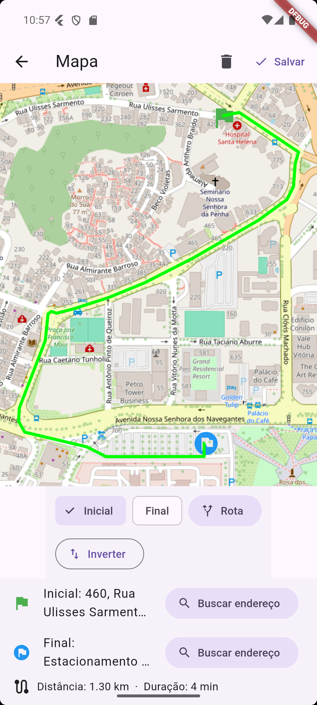
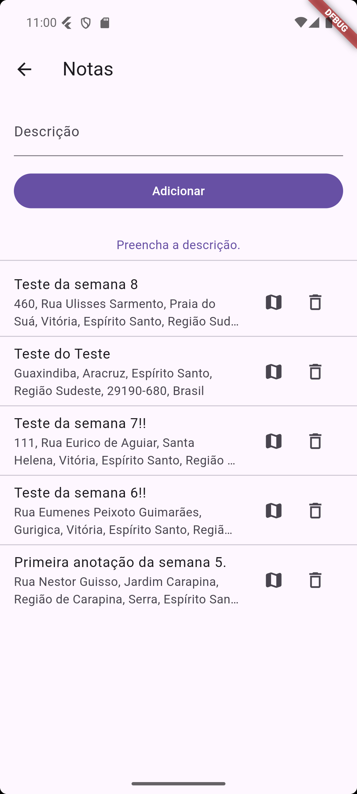

# 🔥 FirebaseApp - Semana 8

Atividade desenvolvida para a disciplina **Desenvolvimento de Aplicativos II**.

## 📌 Objetivo da semana

Nesta oitava semana, o objetivo foi gerar rotas entre dois pontos selecionados no mapa, utilizando o OpenRouteService.

O aplicativo passou a permitir a seleção de um ponto inicial e de um ponto final, o cálculo da rota entre eles e o salvamento da distância, da duração e da linha da rota junto com a anotação no Cloud Firestore.

## ✅ O que foi realizado

- Criação da branch **semana8**
- Configuração de uma chave do OpenRouteService no Cloud Firestore
- Alteração da tela de geolocalização para selecionar ponto inicial e ponto final
- Inclusão de marcadores diferentes para os pontos inicial e final
- Geração de rotas utilizando o perfil `driving-car`
- Exibição da linha da rota no mapa
- Exibição da distância e da duração estimada do percurso
- Inclusão da opção para inverter os pontos inicial e final
- Salvamento dos pontos, endereços, rota, distância e duração junto com a anotação
- Reabertura da anotação com a rota salva corretamente
- Correção do cadastro conforme o feedback da Semana 7
- Teste do aplicativo no emulador Pixel 7
- Publicação da branch **semana8** no GitHub

## 🚀 Tecnologias utilizadas

- 🐦 Flutter
- 🎯 Dart
- 🔥 Firebase
- 🔐 Firebase Authentication
- 🗄️ Cloud Firestore
- 🗺️ Flutter Map
- 🌍 OpenStreetMap
- 🧭 OpenRouteService
- 📍 Geolocalização
- 🔎 Geocodificação reversa com Nominatim
- 🧩 FlutterFire CLI
- 💻 Visual Studio Code
- 🟢 Android Studio
- 🌱 Git
- 🐙 GitHub
- 📱 Android Emulator

## 🧭 Configuração das rotas

As rotas foram implementadas no arquivo:

```text
lib/maps.dart
```

O aplicativo envia as coordenadas dos pontos inicial e final para a API do OpenRouteService utilizando o endpoint:

```text
https://api.openrouteservice.org/v2/directions/driving-car/geojson
```

As coordenadas são enviadas no formato longitude e latitude. A resposta GeoJSON é convertida em uma linha exibida sobre o mapa.

## 🔐 Chave do OpenRouteService

Para não deixar a chave diretamente no código, ela foi cadastrada no Cloud Firestore em:

```text
Coleção: config
Documento: osr
Campo: key
```

O aplicativo consulta esse campo antes de solicitar a rota.

## 🔥 Dados salvos no Firebase

Além da descrição da anotação, foram adicionados dados referentes à rota:

```text
initial
final
distanceM
durationS
polyline6
mode
```

Os pontos inicial e final armazenam suas coordenadas e endereços. A linha codificada da rota permite abrir novamente o mapa sem precisar gerar a rota outra vez.

## ▶️ Comandos utilizados

Execução do aplicativo no emulador Pixel 7:

```bash
flutter run --no-enable-impeller -d emulator-5554
```

Publicação da branch no GitHub:

```bash
git add README.md imagens/semana8 lib/maps.dart lib/notes.dart lib/sign.dart
git commit -m "Semana 8"
git push -u origin semana8
```

## 📁 Arquivos alterados/criados

Durante a atividade, foram utilizados principalmente os arquivos:

```text
lib/maps.dart
lib/notes.dart
lib/sign.dart
README.md
imagens/semana8/mapa-rota.png
imagens/semana8/notas-semana8.png
```

## 📸 Evidências da execução

### Rota entre dois pontos em Vitória



### Anotação com os endereços salvos



## 🧪 Resultado obtido

O aplicativo foi executado com sucesso no emulador **Pixel 7**, utilizando Android 15 e API 35.

Após entrar no aplicativo, acessar **Notas** e abrir a tela de geolocalização, foi possível:

- Selecionar o ponto inicial no mapa
- Selecionar o ponto final no mapa
- Consultar os endereços correspondentes
- Gerar uma rota entre os dois pontos
- Visualizar a rota sobre o mapa
- Visualizar a distância de **1,30 km** e a duração estimada de **4 minutos**
- Salvar a rota junto com a anotação
- Reabrir a anotação e visualizar novamente a rota salva

## 💬 Observações

Nesta etapa foram implementados os recursos de geração e persistência de rotas. O aplicativo utiliza o OpenStreetMap para a visualização do mapa, o Nominatim para a consulta dos endereços e o OpenRouteService para calcular o percurso entre os pontos selecionados.

Também foram realizados os ajustes solicitados no feedback da Semana 7 no arquivo `lib/sign.dart`, incluindo a validação de e-mail, o tratamento dos erros do Firebase Authentication e o botão **Voltar**.

## 👨‍💻 Autor

Robson Silva Ribeiro

## 🔗 Repositório

[https://github.com/Robson-ifes/FirebaseApp](https://github.com/Robson-ifes/FirebaseApp)

## 🌿 Branch da atividade

```text
semana8
```
